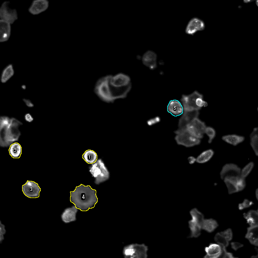
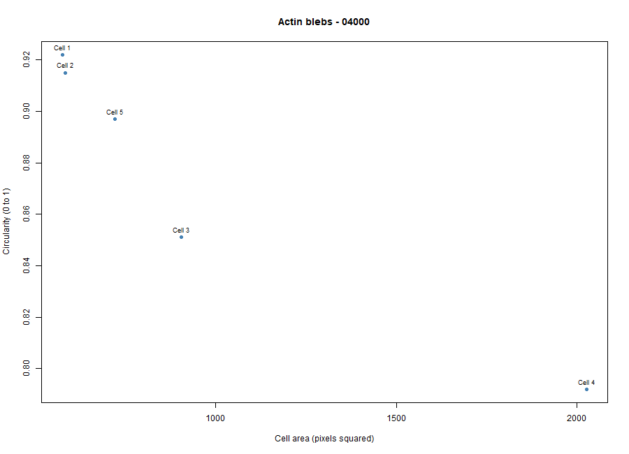
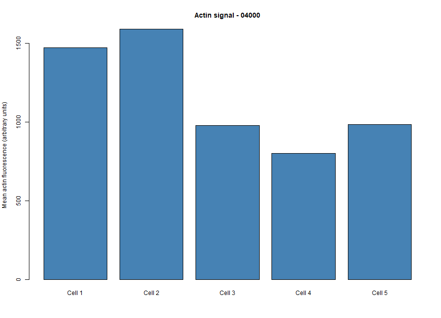

# Cytoskeleton and Cell Morphology (BBBC018)

**Student ID:** 202400730

**Chosen phenotype (my visual classification):** Actin blebs

**Actin image:** 4000-actin.DIB

**DNA image:** 4000-DNA.DIB

**Unique image-field ID:** 4000

**Dataset download:** https://data.broadinstitute.org/bbbc/BBBC018/BBBC018_v1_images.zip

We used image set BBBC018v1 from the Broad Bioimage Benchmark Collection (Ljosa et al., Nature Methods, 2012). The images are licensed CC BY-NC-SA 3.0.

## Brief Fiji steps

I downloaded and unzipped BBBC018_v1_images.zip, then opened 4000-actin.DIB and its matching 4000-DNA.DIB in Fiji. I used the DNA image to check that each outline held only one nucleus. In Analyze > Set Measurements I checked Area, Mean gray value, Shape descriptors, and Display label, and left Limit to threshold unchecked. I traced five isolated cells on the actin image with the Freehand Selection tool, added each one to ROI Manager, and measured them. I saved the Results table as data/fiji_results.csv and an annotated image of the outlines as figures/measured_cells.png. The original DIB images were not changed.

## R analysis

I ran scripts/analyze_cells.R on the Fiji results. Across the 5 cells, the mean area was about 963 pixels squared, the mean circularity was 0.88, the mean aspect ratio was 1.15, and the mean actin signal was about 1165 arbitrary units.

## Answers

**1. Which specific phenotype did you choose, and what visible features support that choice?**

I chose Actin blebs. Field 4000 has mostly isolated, rounded cells, and many of them have a bright actin rim and scalloped, bumpy edges, which looks like the Actin blebs example on the BBBC018 page. This is my own visual classification and not a verified label.

**2. Were your five cells mostly round or elongated?**

They were mostly round. Circularity ranged from 0.79 to 0.92 and aspect ratio ranged from 1.07 to 1.23, so none of them were really elongated. Cell 4 was the largest and least circular (2027 pixels squared, circularity 0.79), which fits its bumpy edge.

**3. What role does actin play in maintaining cell shape and in cell movement (Karp Chapter 9)?**

Actin filaments form a network under the plasma membrane (the cell cortex) that gives the cell its shape and mechanical support. In movement, actin polymerizes at the leading edge and pushes the membrane forward to form protrusions like lamellipodia and filopodia, and myosin helps with contraction.

**4. Why can a single fixed fluorescence image NOT show how fast a cell moves?**

A fixed image is only one snapshot at one moment, so it shows where the cell is and what shape it has, but not where it was before or after. Speed needs the cell's position at several time points, which we don't have here.
